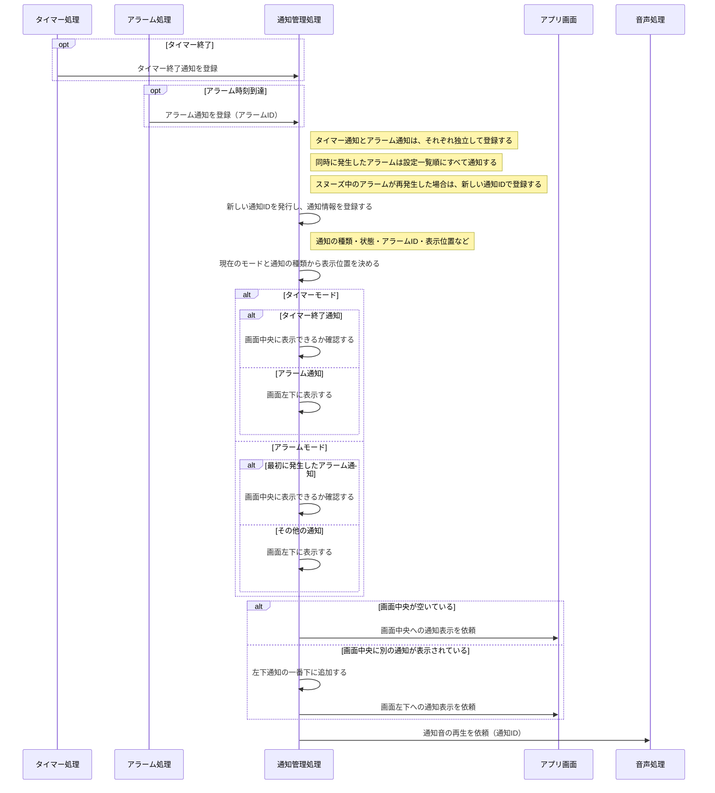
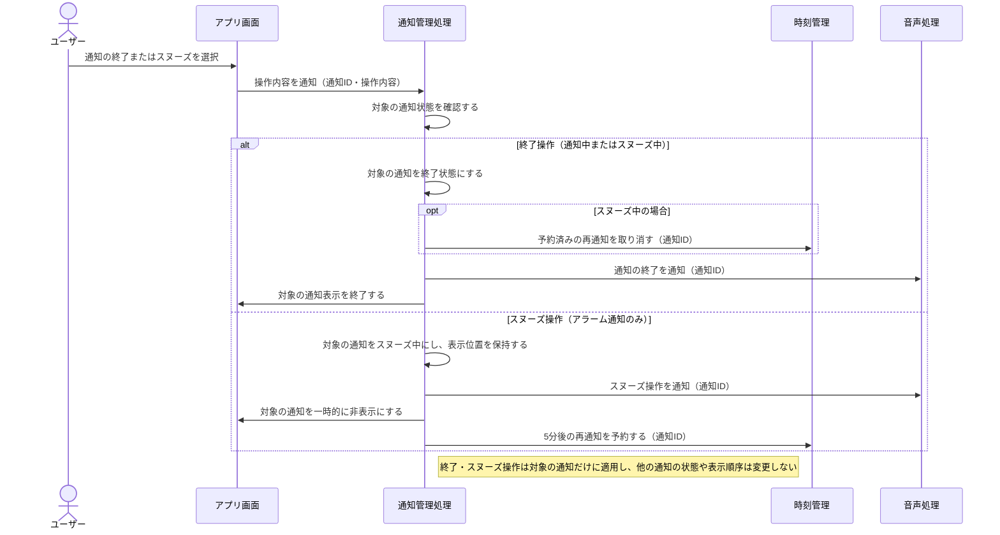
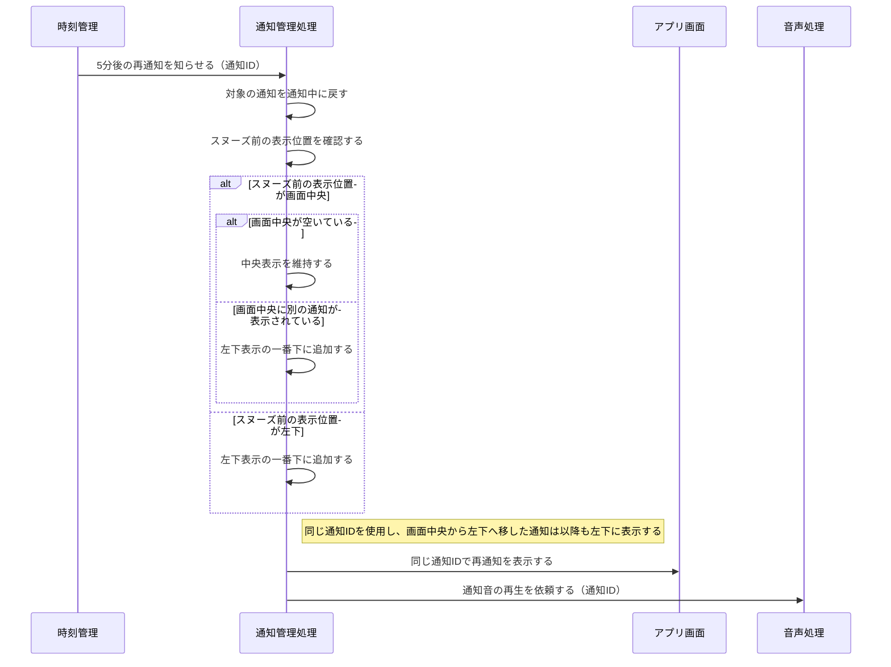
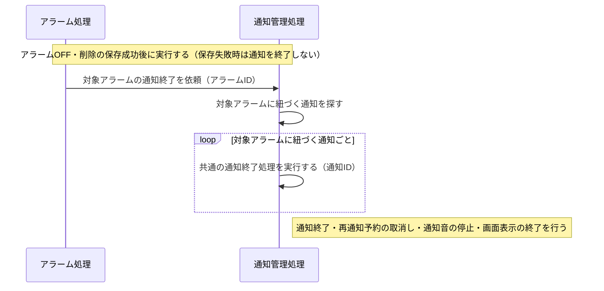
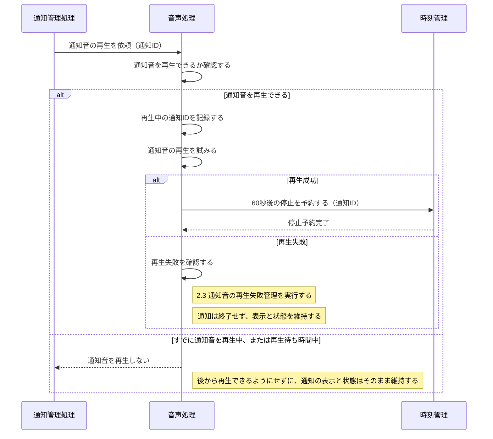
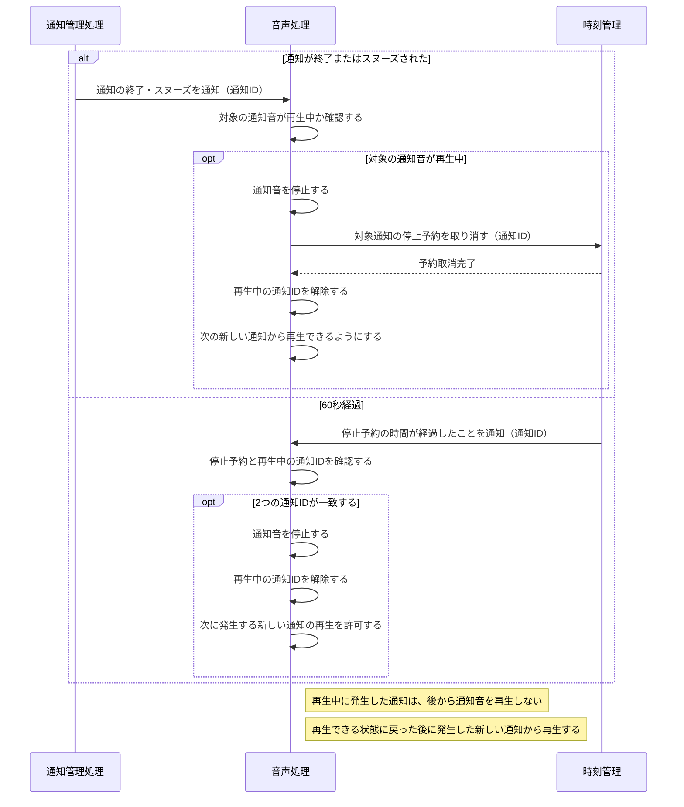
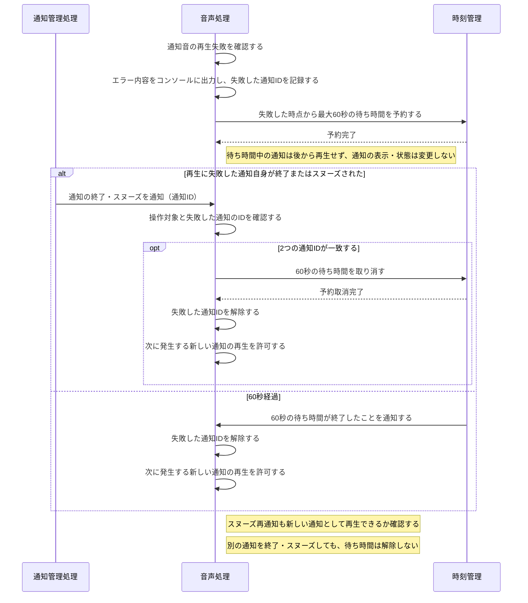
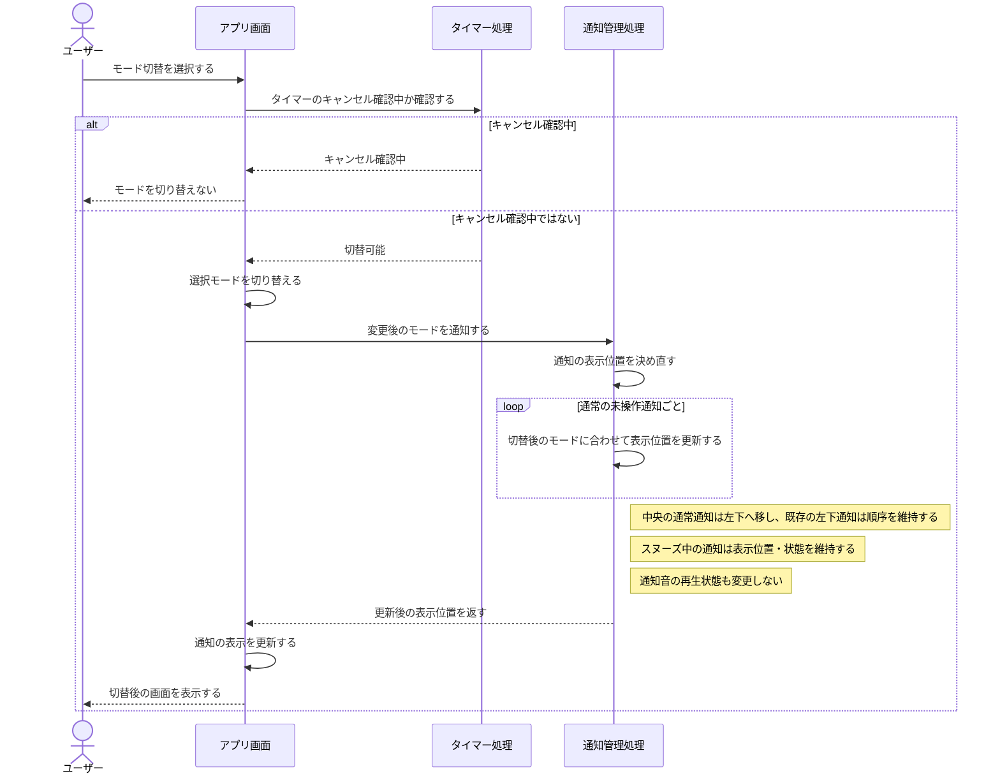
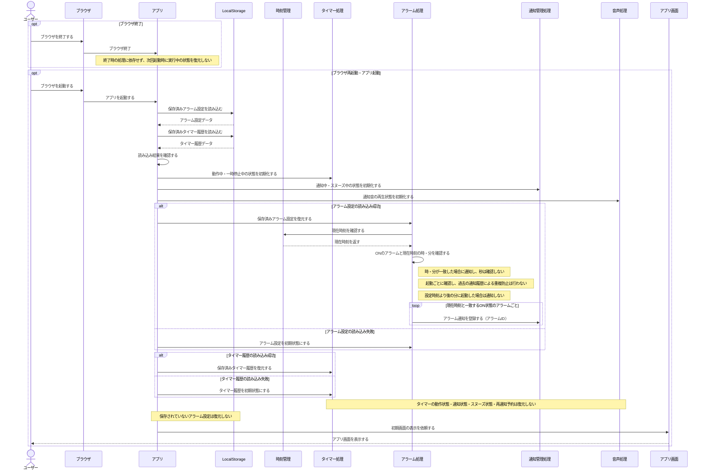

# 共通シーケンス図
## 1. 共通通知管理
### 1.1 通知登録・表示位置決定

### 1.2 通知終了・スヌーズ操作

### 1.3 スヌーズ再通知

### 1.4 アラームOFF・削除時の通知終了

## 2. 共通通知音管理
### 2.1 通知音の再生判定・開始

### 2.2 通知音の停止・再生時間管理

### 2.3 通知音の再生失敗管理

## 3. 共通モード切替

## 4. ブラウザ終了・再起動
